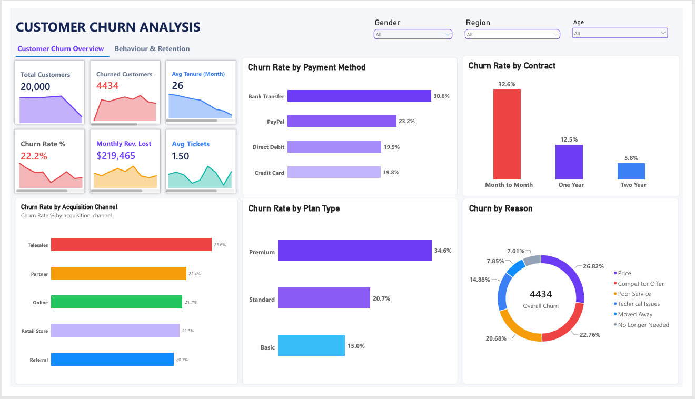
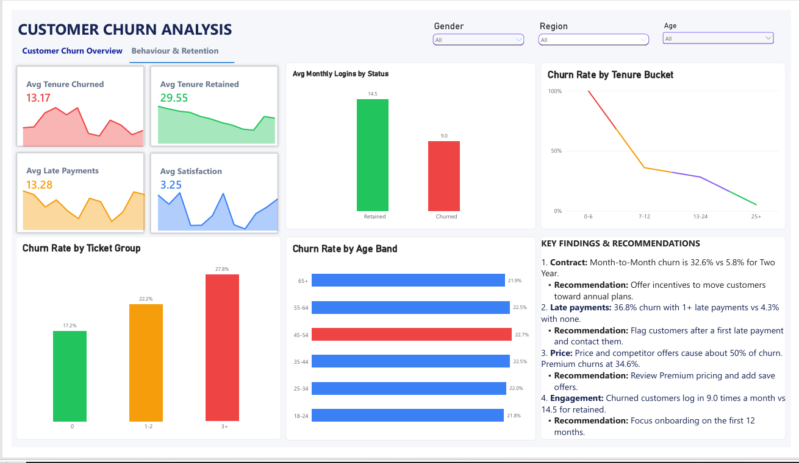

# Customer Churn Analysis

## Project Overview

The Customer Churn Analysis project explores why customers leave a subscription business using an end-to-end workflow: data cleaning in Power Query, analysis in MySQL, and an interactive two-page dashboard in Power BI. The project focuses on churn rate, customer segments, customer behaviour, and retention.

The goal is to organise customer data into meaningful visualisations that make churn easier to understand and help decision-makers identify where retention efforts may be needed.

> **Note:** The dataset is synthetic and was created for practice. The findings illustrate the analysis method and should not be read as real-world conclusions.

## Project Objectives

- Measure the overall churn rate and the revenue lost to churn.
- Compare churn across contract type, plan type, payment method, and acquisition channel.
- Examine customer behaviour, including logins, late payments, and support tickets.
- Explore how churn changes with customer tenure and age.
- Present churn information through an interactive dashboard.
- Support retention decisions with clear findings and recommendations.

## Tools and Technologies

- **Excel / Power Query:** Data cleaning and transformation.
- **MySQL:** Joins, `CASE` statements, a combined analysis view, and SQL validation of the dashboard.
- **Power BI:** Dashboard development and data visualisation.
- **DAX:** Measures and calculated columns for analysing churn.

## Dashboard Pages

### 1. Churn Overview

This page gives an overview of churn across the business. It is designed to help users see the overall churn position and compare churn across key customer segments.

**Purpose:**

- Review the overall churn rate and customers lost.
- Measure monthly revenue lost to churn.
- Compare churn across contract, plan, payment method, and acquisition channel.
- Understand the reasons customers give for leaving.

**Dashboard Screenshot**

### 2. Behaviour and Retention

This page focuses on customer behaviour and how it relates to churn. It provides a way to explore engagement, support activity, and tenure, and to identify early warning signs.

**Purpose:**

- Compare tenure for churned and retained customers.
- Compare login activity for churned and retained customers.
- Examine how churn changes with the number of support tickets.
- Explore churn by tenure bucket and age band.

**Dashboard Screenshot**

## Data Preparation and Analysis

Excel and Power Query were used for data cleaning. MySQL was used to join the four tables, calculate churn rates by segment, and build a combined view with one row per customer. Power BI and DAX were then used to build the measures and visualisations.

**Data cleaning (Power Query)**

- Removed duplicate customers and subscriptions.
- Standardised mixed date formats (`dd/MM/yyyy` and `yyyy-MM-dd`).
- Trimmed and re-cased text fields such as city, region, and gender.
- Replaced impossible ages (-1) with nulls and labelled missing gender as "Unknown".
- Standardised contract type labels.

**Analysis (MySQL)**

- Joined four tables: customers, subscriptions, monthly usage, and support tickets.
- Used `CASE` statements to create age bands, tenure buckets, and ticket groups.
- Built a combined view (`churn_analysis`) for Power BI.
- A customer is counted as churned when `end_date` is not null.

**Visualisation (Power BI)**

- Connected to the `churn_analysis` view.
- Wrote DAX measures for churn rate, churned customers, revenue lost, average tenure, and average tickets per customer.
- Built calculated columns for status, ticket group, tenure bucket, and age band.
- Added KPI cards, slicers, and page navigation.

**Validation**

Dashboard figures were checked against separate SQL queries on the base tables, and the results matched.

## Data Model

| Table | Rows | Description |
|---|---|---|
| `customers` | 20,000 | Demographics, region, acquisition channel, signup date |
| `subscriptions` | 20,000 | Plan, contract, payment method, monthly charge, start and end date, churn reason |
| `monthly_usage` | 120,000 | Six months of logins, data usage, and late payments per customer |
| `support_tickets` | 30,000 | Ticket category, resolution time, satisfaction score |

## Key Areas of Analysis

| Analysis Area | Focus |
|---|---|
| Overall Churn | Churn rate, customers lost, and monthly revenue lost |
| Contract and Plan | Churn by contract type and plan type |
| Payment and Channel | Churn by payment method and acquisition channel |
| Customer Behaviour | Logins, late payments, and support tickets |
| Tenure | When customers leave |
| Demographics | Age, gender, and region |
| Churn Reasons | Why customers say they left |

## Key Findings

**Headline numbers:** 22.2% churn rate, 4,434 of 20,000 customers lost, and about $219K monthly revenue lost.

| Driver | Finding |
|---|---|
| Contract type | Month-to-Month churn is **32.6%**, compared with 12.5% (One Year) and 5.8% (Two Year) |
| Late payments | **36.8%** churn with one or more late payments, compared with 4.3% with none |
| Plan type | Premium churns at **34.6%**, compared with 20.7% (Standard) and 15.0% (Basic) |
| Churn reasons | Price (26.8%) and competitor offers (22.8%) make up about half of stated reasons |
| Engagement | Churned customers log in **9.0** times a month, compared with 14.5 for retained customers |
| Support tickets | Churn rises with ticket volume: 17.2% (0 tickets), 22.2% (1-2), 27.8% (3+) |
| Payment method | Bank Transfer churns at **30.6%**, compared with about 20% for Direct Debit and Credit Card |
| Acquisition channel | Telesales is highest at **26.6%**, and Referral is lowest at 20.3% |
| Tenure | Churned customers leave after about 13 months on average; retained customers have stayed about 30 |
| Age, gender, region, satisfaction | Little difference between groups, so these are not churn drivers in this dataset |

## Recommendations

1. **Move Month-to-Month customers to annual plans** with incentives, since contract type is the strongest driver.
2. **Flag customers after their first late payment** and contact them early.
3. **Review Premium pricing** and introduce save offers for customers who cite price or competitor offers.
4. **Focus onboarding on the first 12 months** and monitor customers whose logins drop.
5. **Review telesales acquisition quality**, since those customers churn the most.

## Business Value

This project demonstrates how customer data can be organised into an interactive dashboard to support churn monitoring and retention planning.

The dashboard gives a structured view of churn by segment and behaviour. These views can help business users identify at-risk customers, ask better questions, and decide where retention effort is likely to matter most.

## Skills Demonstrated

- Data cleaning and transformation
- SQL (joins, `CASE` statements, views, aggregation)
- Data analysis
- Data visualisation
- Dashboard development
- DAX measures and calculated columns
- Validating dashboard results against SQL
- Customer behaviour and retention analysis
- Communicating findings and recommendations

## Limitations

- The data is synthetic, so relationships in it were built in on purpose.
- Active customers are measured up to 30 June 2025. Every customer in the 0-6 month tenure bucket has churned, so that bucket shows 100% churn. Treat the tenure chart as indicative rather than precise.
- Correlation is not causation. Drivers such as late payments may be symptoms of churn as well as causes.

## Conclusion

The Customer Churn Analysis project demonstrates the use of Excel, Power Query, MySQL, Power BI, and DAX to explore customer churn through a two-page interactive dashboard.

By presenting churn by segment, customer behaviour, and retention recommendations in one project, it shows how data analytics can make customer data easier to understand and act on.

---

**Tools:** Excel | Power Query | MySQL | Power BI | DAX

**Project Type:** Customer Churn and Retention Analysis
